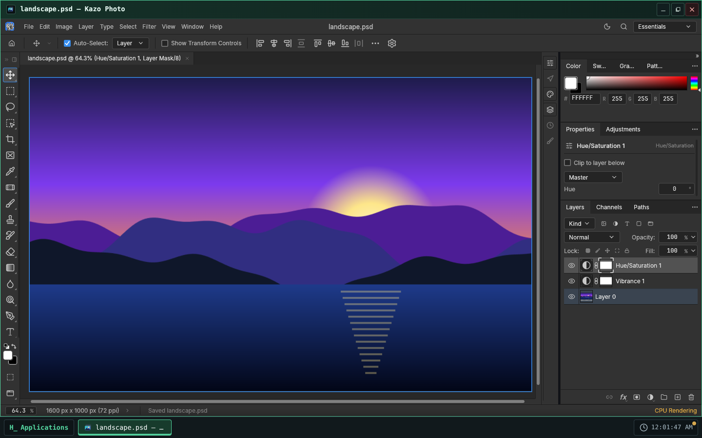
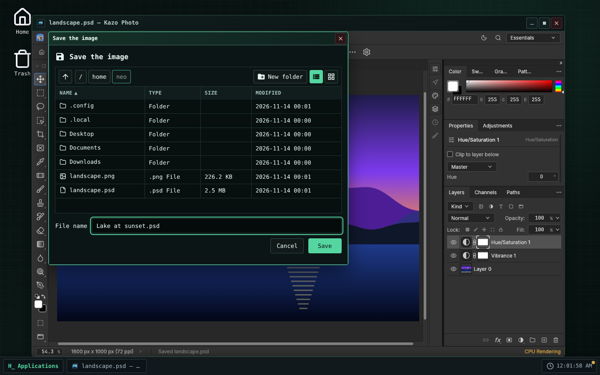
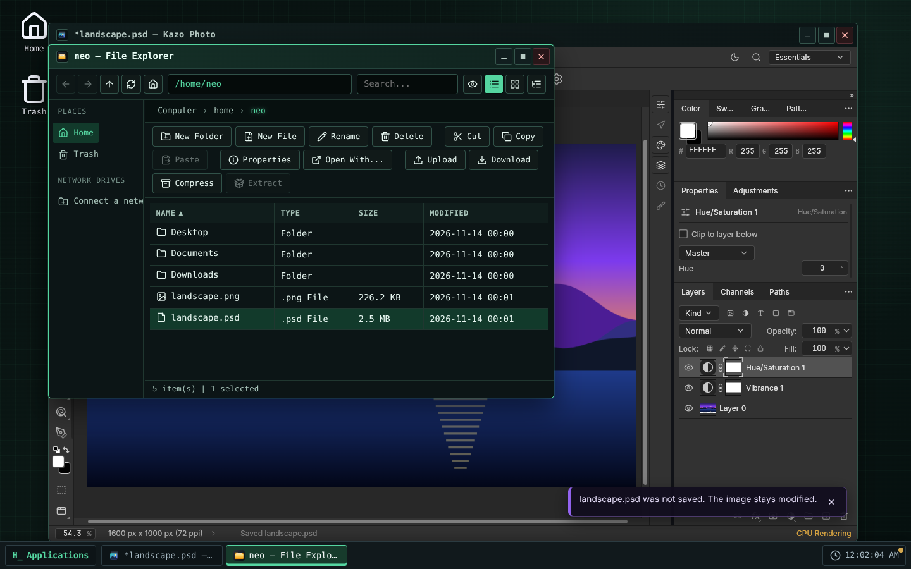

> [Version française](readme-fr.md)

<!-- Store listing: generated from store/ by .github/scripts/store-readme.mjs. Edit store/, then run it. -->


# Kazo Photo

A layered image editor for Kazo OS. Kazo Photo is based on
[PhotoCraft](https://github.com/storytold/photocraft) by the ArtCraft team, an open-source image
editor written in Rust, which runs here in a Kazo OS window.

## Edit images

- Layers, groups, layer masks and blend modes; adjustment layers (Levels, Curves, Hue/Saturation,
  Vibrance, Black & White, Gradient Map…) that keep the original pixels.
- Layer styles: shadows, glows, bevel, stroke, color, gradient and pattern overlays.
- Selections: marquees, lassos, Magic Wand, Quick Selection, Select and Mask.
- Brushes, retouching tools, gradients, type layers and vector shapes.
- Filters with a live preview: blur, sharpen, distort, noise, and more.
- Opens and saves layered `.psd` and `.psb` files, and reads many other formats: PNG, JPEG, WebP,
  TIFF, GIF, BMP, SVG, OpenRaster, Krita, GIMP, camera RAW files, HEIC, EXR and more.
- Several windows at once, each with its own images in tabs.

## Your Kazo OS files

- Double-click a `.psd`, a RAW photo or another layered image in the File Explorer: it opens in
  Kazo Photo. PNG, JPEG, GIF, BMP, WebP and SVG images list it in "Open with".
- Save rewrites the open file. Save As, and the first save of a new image or of a flat image that
  now has layers, go through the Kazo OS save dialog.
- Save a Copy and Export As go through the Kazo OS "Save a copy" dialog: the image stays bound to
  its file. Nothing goes to the browser's downloads.
- Closing the window asks before losing changes, for each open image.
- File › Open, and the files to place or import, come from the Kazo OS files, through the Kazo OS
  dialog. Opening a file whose name is already taken in a window opens a new window.
- The text tool offers about fifteen font families (Roboto, Open Sans, Lato, Montserrat, Liberation,
  Source Serif…), shipped with the app under the SIL Open Font License.
- Kazo Photo follows the OS theme (light or dark) and language; its settings are kept per Kazo OS
  user in `~/.config/ca.kazo.photo/`.

## Known limits

- **PhotoCraft is in early alpha.** Most images open and save fine, but keep a copy of the
  important ones.
- Kazo OS opens files up to 128 MiB. Large images are slow to open and save (about 40 seconds for a
  50 MB `.psd`), and each window needs a lot of memory (about 600 MB, more with large images). On a
  whole large image, some filters stop with "not enough working memory".
- Brushes, gradients, patterns and other presets are kept by the browser, shared by every Kazo OS
  user of that browser.
- No Chinese, Japanese or Korean font is shipped; text in those scripts may show as boxes.
- PhotoCraft draws with WebGPU or WebGL 2: a browser or a computer without either shows an error
  screen instead of the image.
- Two PhotoCraft shortcuts belong to Kazo OS: Alt+F9 (use Window › Actions) and holding Alt+Space
  to zoom out (use Ctrl+-).
- After Save As, the tab keeps the name PhotoCraft proposed; the window title shows the chosen file.
- The window stays on the screen where it opened: moving it to another screen would reload
  PhotoCraft and lose the open images.
- The download is about 25 MB (59 MB once installed), and each window loads its own copy of
  PhotoCraft.
- Needs Kazo OS 3.3.4 or later.

## License

Kazo Photo is free software under the MIT license. PhotoCraft is under the MIT or Apache-2.0
license; its notices, the licenses of the icons and data it carries, and those of the fonts (SIL
Open Font License 1.1) ship with the app (see `THIRD-PARTY-NOTICES.md` in the repository). The
ArtCraft name and logos are trademarks of the ArtCraft team and are not used by Kazo Photo.

## Screenshots

<p>
  
  
  
</p>

<!-- /Store listing -->

## Try it

[Open Kazo Photo in Kazo OS](https://os.kazo.ca/?autolaunch=ca.kazo.photo): the link starts Kazo OS, installs the app from the official Store and opens it.

Or open [Kazo OS](https://os.kazo.ca/) and install Kazo Photo from the **Kazo OS Store** (category Graphics), or in the Kazo OS Terminal, as an administrator: `sudo kazopkg install Kazo-ca/Os-App-Photo`.

## About Kazo OS

[Kazo OS](https://github.com/Kazo-ca/Os) is a simulated operating system that runs in the browser, written in C# with Blazor WebAssembly. It gives a complete environment to build and run applications: desktop and windows, a persistent file system, processes, a POSIX shell, a simulated network, the Kazo OS Store, and a public SDK (NuGet packages) to make apps such as this one. Try it at <https://os.kazo.ca/> (PWA, works offline).

## Development

- Plan: [plan](doc/en/plan.md). PhotoCraft's notices, the fonts and the licenses in the package: [THIRD-PARTY-NOTICES.md](THIRD-PARTY-NOTICES.md).

| Folder | Content |
| --- | --- |
| `src/Kazo.Photo` | The app (window app, its `[AppManifest]` class generates `manifest.json`) |
| `src/Kazo.Photo.Os` | A host that runs the whole Kazo OS with the base apps and this app: the project to start |
| `tests/Kazo.Photo.Tests` | Tests of the app (xUnit) |
| `tests/e2e` | End-to-end runs in the Kazo OS host (Playwright): `npm run test:e2e` after `dotnet build Kazo.Photo.slnx -c Debug` |
| `external/KazoOs` | The Kazo OS repository as a git submodule, on a release tag |
| `external/photocraft` | PhotoCraft's sources (our fork `Kazo-ca/photocraft`) as a git submodule, only to compile PhotoCraft (`tools/build-photocraft.sh`, workflow Build PhotoCraft) |
| `src/Kazo.Photo/wwwroot/photocraft` | The PhotoCraft web build and its provenance `photocraft.json`, written by `tools/build-photocraft.sh`, never edited by hand |
| `store/` | What the Kazo OS Store shows: icon (PNG 256×256), short descriptions, descriptions, screenshots, `store.json` |
| `tests/installed` | The app as the Store installs it, in a published Kazo OS: `kazopkg install`, a `.psd` opened by double-click and saved, the Store screenshots (`npm run test:installed`) |
| `THIRD-PARTY-NOTICES.md` | PhotoCraft, what it bundles, and the fonts; linked into the package with `LICENSE` (`wwwroot/legal/`, with the license files PhotoCraft refers to in `wwwroot/legal/photocraft/`) |

### Compiling PhotoCraft

`tools/build-photocraft.sh` compiles the commit of `external/photocraft` with Trunk 0.21.14, Rust
stable and the `wasm32-unknown-unknown` target, with the translations of `craft-i18n` at the
revision PhotoCraft pins (about 13 minutes from scratch on 4 cores), then replaces
`src/Kazo.Photo/wwwroot/photocraft/` with the result and its provenance. The **Build PhotoCraft**
workflow (Actions tab) does the same and opens a pull request with the build. To move to another
PhotoCraft commit: move the submodule to a commit of the fork, then rebuild; a test fails while
the build and the submodule disagree.

### First steps

```bash
# A repository created from the GitHub template already has the submodule:
git clone --recurse-submodules <your repository>

# A folder made with "dotnet new kazoos-solution" adds it once:
git init
git submodule add --depth 1 https://github.com/Kazo-ca/Os.git external/KazoOs
git -C external/KazoOs checkout v<Kazo OS version>
```

Then open `Kazo.Photo.slnx` in Visual Studio or Rider and start `Kazo.Photo.Os`, or run
`dotnet run --project src/Kazo.Photo.Os`.

### The Kazo OS version

`external/KazoOs/wasm2/KazoOs/build/Versions.props` is the Kazo OS version of this repository.
To move to another version, move the submodule to its tag and commit it:

```bash
git -C external/KazoOs fetch --depth 1 origin tag v2.2.0
git -C external/KazoOs checkout v2.2.0
git add external/KazoOs
```

Never edit the submodule: the OS is not modified from an app repository, and CI refuses a
submodule with local changes or off its tag.

### Two build profiles

| Profile | Kazo OS comes from | Use |
| --- | --- | --- |
| `Debug` | the projects of the submodule (`KazoOsUseSource=true`) | step into the SDK and the OS, breakpoints anywhere |
| `Release` | the `Kazo.Os.*` packages of nuget.org, at the submodule's version | CI, `dotnet publish`, the Kazo OS Store |

Force either one with `-p:KazoOsUseSource=true` or `false`.

### Publishing to the Kazo OS Store

1. Fill `store/` (icon, short descriptions, descriptions, category and tags in `store.json`).
2. Change `Version` in the app's `[AppManifest]` class and commit it to `main`, then tag it: run the
   **Tag a release** workflow (Actions tab, or the GitHub API for an agent), which tags the head of
   `main` with the manifest's version and starts the two publishing workflows; or push the tag
   yourself: `git tag v1.0.0 && git push --tags`.
3. The **Publish to the Kazo OS Store** workflow builds the app and makes the catalog folder
   `apps/<appId>_<version>/`. With a `HACK_STORE_TOKEN` secret (a token allowed to fork and open
   pull requests), it opens the pull request to `Kazo-ca/Os-AppMarketPlace` from your fork;
   without it, download the run's artifact and open the pull request yourself.

`HACK_STORE_TOKEN` is a GitHub personal access token of yours, not something Kazo OS gives you:

1. GitHub ▸ **Settings** ▸ **Developer settings** ▸ **Personal access tokens** ▸ **Tokens (classic)** ▸
   **Generate new token (classic)**, with a short expiration and the **`repo`** and **`workflow`**
   scopes (a fine-grained token cannot cover both your fork and the catalog's repository).
2. Copy it (shown once) into this repository: **Settings** ▸ **Secrets and variables** ▸ **Actions** ▸
   **New repository secret**, name `HACK_STORE_TOKEN` (or `gh secret set HACK_STORE_TOKEN`).

`repo` reaches all your repositories: keep the token only in this secret and revoke it if in doubt.

The catalog never takes a binary from you: once your pull request is reviewed and merged, its CI
compiles the app at the tagged commit.

### Publishing on the `kazoos-packages` branch

The same `v*` tag also runs **Publish the Kazo OS packages**: it packs the app and pushes it to the
`kazoos-packages` branch of this repository, keeping the versions already published. Kazo OS
users then install it with `kazopkg install <owner>/<repo>`, without the Kazo OS Store.

These packages are not signed: apps are signed only in the Kazo OS Store repository
(`Kazo-ca/Os-AppMarketPlace`), when it builds your app from the catalog (ADR 0219). Kazo OS checks
them by their SHA-256 and asks an administrator before installing from an untrusted source. Users
who want a signed package install your app from the Kazo OS Store.
