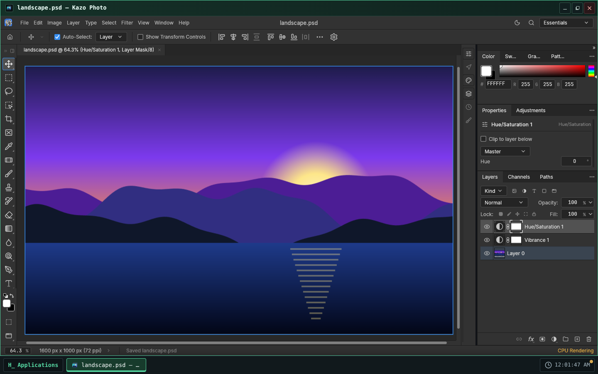
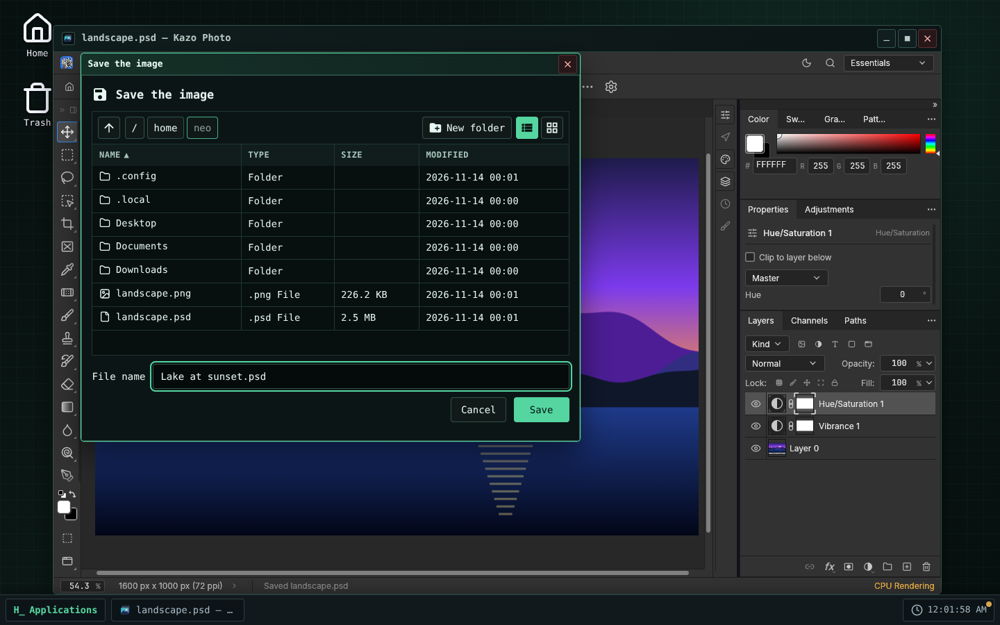
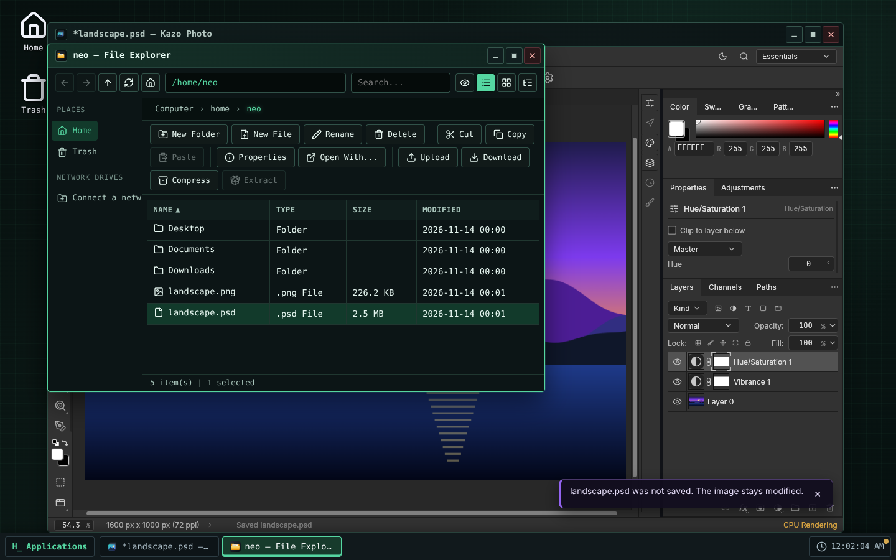

> [English version](README.md)

<!-- Fiche du Store : générée depuis store/ par .github/scripts/store-readme.mjs. Modifiez store/, puis lancez-le. -->


# Kazo Photo

Un éditeur d'images à calques pour Kazo OS. Kazo Photo est basé sur
[PhotoCraft](https://github.com/storytold/photocraft) de l'équipe ArtCraft, un éditeur d'images
libre écrit en Rust, qui tourne ici dans une fenêtre de Kazo OS.

## Retoucher des images

- Calques, groupes, masques de fusion et modes de fusion ; calques de réglage (Niveaux, Courbes,
  Teinte/Saturation, Vibrance, Noir et blanc, Courbe de transfert de dégradé…) qui gardent les
  pixels d'origine.
- Styles de calque : ombres, lueurs, biseau, contour, incrustations de couleur, de dégradé et de
  motif.
- Sélections : rectangle et ellipse, lassos, baguette magique, sélection rapide, Sélectionner et
  masquer.
- Pinceaux, outils de retouche, dégradés, calques de texte et formes vectorielles.
- Filtres avec aperçu en direct : flou, netteté, déformation, bruit, et d'autres.
- Ouvre et enregistre les fichiers à calques `.psd` et `.psb`, et lit beaucoup d'autres formats :
  PNG, JPEG, WebP, TIFF, GIF, BMP, SVG, OpenRaster, Krita, GIMP, fichiers RAW d'appareils photo,
  HEIC, EXR et d'autres.
- Plusieurs fenêtres à la fois, chacune avec ses images en onglets.

## Vos fichiers Kazo OS

- Double-cliquez sur un `.psd`, une photo RAW ou une autre image à calques dans l'Explorateur de
  fichiers : elle s'ouvre dans Kazo Photo. Les images PNG, JPEG, GIF, BMP, WebP et SVG le proposent
  dans « Ouvrir avec ».
- Enregistrer réécrit le fichier ouvert. Enregistrer sous, et le premier enregistrement d'une
  nouvelle image ou d'une image plate qui a maintenant des calques, passent par le dialogue
  d'enregistrement de Kazo OS.
- Enregistrer une copie et Exporter sous passent par le dialogue « Enregistrer une copie » de
  Kazo OS : l'image reste liée à son fichier. Rien ne part dans les téléchargements du navigateur.
- Fermer la fenêtre demande avant de perdre des modifications, pour chaque image ouverte.
- Fichier › Ouvrir, et les fichiers à importer ou à placer, viennent des fichiers Kazo OS, par le
  dialogue de Kazo OS. Ouvrir un fichier dont le nom est déjà pris dans une fenêtre ouvre une
  nouvelle fenêtre.
- L'outil Texte propose une quinzaine de familles de polices (Roboto, Open Sans, Lato, Montserrat,
  Liberation, Source Serif…), livrées avec l'app sous SIL Open Font License.
- Kazo Photo suit le thème (clair ou sombre) et la langue de l'OS ; ses réglages sont gardés par
  utilisateur Kazo OS dans `~/.config/ca.kazo.photo/`.

## Limites connues

- **PhotoCraft est en alpha.** La plupart des images s'ouvrent et s'enregistrent bien, mais gardez
  une copie des plus importantes.
- Kazo OS ouvre les fichiers jusqu'à 128 Mio. Les grandes images sont lentes à ouvrir et à
  enregistrer (environ 40 secondes pour un `.psd` de 50 Mo), et chaque fenêtre demande beaucoup de
  mémoire (environ 600 Mo, davantage avec de grandes images). Sur une grande image entière,
  certains filtres s'arrêtent avec « not enough working memory ».
- Les pinceaux, dégradés, motifs et autres préréglages sont gardés par le navigateur, partagés par
  tous les utilisateurs Kazo OS de ce navigateur.
- Aucune police chinoise, japonaise ou coréenne n'est livrée ; ce texte peut s'afficher en carrés.
- PhotoCraft dessine avec WebGPU ou WebGL 2 : un navigateur ou un ordinateur sans l'un ni l'autre
  montre un écran d'erreur au lieu de l'image.
- Deux raccourcis de PhotoCraft appartiennent à Kazo OS : Alt+F9 (passez par Fenêtre › Actions) et
  Alt+Espace maintenu pour dézoomer (utilisez Ctrl+-).
- Après Enregistrer sous, l'onglet garde le nom proposé par PhotoCraft ; le titre de la fenêtre
  montre le fichier choisi.
- La fenêtre reste sur l'écran où elle s'est ouverte : la passer sur un autre écran rechargerait
  PhotoCraft et perdrait les images ouvertes.
- Le téléchargement fait environ 25 Mo (59 Mo une fois installé), et chaque fenêtre charge sa
  propre copie de PhotoCraft.
- Demande Kazo OS 3.3.4 ou plus récent.

## Licence

Kazo Photo est un logiciel libre sous licence MIT. PhotoCraft est sous licence MIT ou Apache-2.0 ;
ses avis, les licences des icônes et données qu'il contient, et celles des polices (SIL Open Font
License 1.1) sont livrés avec l'app (voir `THIRD-PARTY-NOTICES-fr.md` dans le dépôt). Le nom et les
logos ArtCraft sont des marques de l'équipe ArtCraft et ne sont pas utilisés par Kazo Photo.

## Captures d'écran

<p>
  
  
  
</p>

<!-- /Fiche du Store -->

## Essayer

[Ouvrir Kazo Photo dans Kazo OS](https://os.kazo.ca/?autolaunch=ca.kazo.photo) : le lien démarre Kazo OS, installe l'app depuis le Store officiel et l'ouvre.

Ou ouvrez [Kazo OS](https://os.kazo.ca/) et installez Kazo Photo depuis le **Kazo OS Store** (catégorie Graphisme), ou dans le Terminal de Kazo OS, en administrateur : `sudo kazopkg install Kazo-ca/Os-App-Photo`.

## À propos de Kazo OS

[Kazo OS](https://github.com/Kazo-ca/Os) est un système d'exploitation simulé qui tourne dans le navigateur, écrit en C# avec Blazor WebAssembly. Il offre un environnement complet pour développer et exécuter des applications : bureau et fenêtres, système de fichiers persistant, processus, shell POSIX, réseau simulé, le Kazo OS Store, et un SDK public (paquets NuGet) pour créer des apps comme celle-ci. Essayez-le sur <https://os.kazo.ca/> (PWA, fonctionne hors ligne).

## Développement

- Plan : [plan](doc/fr/plan.md). Les avis de PhotoCraft, les polices et les licences du paquet : [THIRD-PARTY-NOTICES-fr.md](THIRD-PARTY-NOTICES-fr.md).

| Dossier | Contenu |
| --- | --- |
| `src/Kazo.Photo` | L'app (app fenêtrée ; sa classe `[AppManifest]` génère `manifest.json`) |
| `src/Kazo.Photo.Os` | Un hôte qui lance tout Kazo OS avec les apps de base et cette app : le projet à démarrer |
| `tests/Kazo.Photo.Tests` | Les tests de l'app (xUnit) |
| `tests/e2e` | Les parcours de bout en bout dans l'hôte Kazo OS (Playwright) : `npm run test:e2e` après `dotnet build Kazo.Photo.slnx -c Debug` |
| `external/KazoOs` | Le dépôt Kazo OS en sous-module git, sur un tag de release |
| `external/photocraft` | Les sources de PhotoCraft (notre fork `Kazo-ca/photocraft`) en sous-module git, seulement pour compiler PhotoCraft (`tools/build-photocraft.sh`, workflow Build PhotoCraft) |
| `src/Kazo.Photo/wwwroot/photocraft` | Le build web de PhotoCraft et sa provenance `photocraft.json`, écrits par `tools/build-photocraft.sh`, jamais modifiés à la main |
| `store/` | Ce que montre le Kazo OS Store : icône (PNG 256×256), descriptions courtes, descriptions, captures, `store.json` |
| `tests/installed` | L'app telle que le Store l'installe, dans un Kazo OS publié : `kazopkg install`, un `.psd` ouvert par double-clic et enregistré, les captures du Store (`npm run test:installed`) |
| `THIRD-PARTY-NOTICES-fr.md` | PhotoCraft, ce qu'il embarque, et les polices ; lié dans le paquet avec `LICENSE` (`wwwroot/legal/`, avec les fichiers de licence que cite PhotoCraft dans `wwwroot/legal/photocraft/`) |

### Compiler PhotoCraft

`tools/build-photocraft.sh` compile le commit de `external/photocraft` avec Trunk 0.21.14, Rust
stable et la cible `wasm32-unknown-unknown`, avec les traductions de `craft-i18n` à la révision
qu'épingle PhotoCraft (environ 13 minutes à froid sur 4 cœurs), puis remplace
`src/Kazo.Photo/wwwroot/photocraft/` par le résultat et sa provenance. Le workflow
**Build PhotoCraft** (onglet Actions) fait la même chose et ouvre une pull request avec le build.
Pour passer à un autre commit de PhotoCraft : déplacer le sous-module sur un commit du fork, puis
recompiler ; un test échoue tant que le build et le sous-module ne concordent pas.

### Premiers pas

```bash
# Un dépôt créé depuis le template GitHub a déjà le sous-module :
git clone --recurse-submodules <votre dépôt>

# Un dossier créé par « dotnet new kazoos-solution » l'ajoute une fois :
git init
git submodule add --depth 1 https://github.com/Kazo-ca/Os.git external/KazoOs
git -C external/KazoOs checkout v<version de Kazo OS>
```

Ouvrez ensuite `Kazo.Photo.slnx` dans Visual Studio ou Rider et démarrez `Kazo.Photo.Os`,
ou lancez `dotnet run --project src/Kazo.Photo.Os`.

### La version de Kazo OS

`external/KazoOs/wasm2/KazoOs/build/Versions.props` est la version de Kazo OS de ce dépôt.
Pour changer de version, placez le sous-module sur son tag et validez-le :

```bash
git -C external/KazoOs fetch --depth 1 origin tag v2.2.0
git -C external/KazoOs checkout v2.2.0
git add external/KazoOs
```

Ne modifiez jamais le sous-module : on ne modifie pas l'OS depuis un dépôt d'app, et la CI refuse
un sous-module modifié ou hors de son tag.

### Deux profils de build

| Profil | Kazo OS vient de | Usage |
| --- | --- | --- |
| `Debug` | les projets du sous-module (`KazoOsUseSource=true`) | entrer dans le SDK et l'OS, points d'arrêt partout |
| `Release` | les paquets `Kazo.Os.*` de nuget.org, à la version du sous-module | CI, `dotnet publish`, le Kazo OS Store |

Forcez l'un ou l'autre avec `-p:KazoOsUseSource=true` ou `false`.

### Publier dans le Kazo OS Store

1. Remplissez `store/` (icône, descriptions courtes, descriptions, catégorie et étiquettes dans `store.json`).
2. Changez `Version` dans la classe `[AppManifest]` de l'app et validez-la dans `main`, puis posez le
   tag : lancez le workflow **Tag a release** (onglet Actions, ou l'API GitHub pour un agent), qui pose
   sur la tête de `main` le tag de la version du manifeste et lance les deux workflows de
   publication ; ou poussez le tag vous-même : `git tag v1.0.0 && git push --tags`.
3. Le workflow **Publish to the Kazo OS Store** compile l'app et produit le dossier du catalogue
   `apps/<appId>_<version>/`. Avec un secret `HACK_STORE_TOKEN` (un jeton qui peut créer un fork et
   ouvrir des pull requests), il ouvre la pull request vers `Kazo-ca/Os-AppMarketPlace` depuis
   votre fork ; sans lui, téléchargez l'artefact du workflow et ouvrez la pull request vous-même.

`HACK_STORE_TOKEN` est un jeton d'accès personnel GitHub à vous, que Kazo OS ne fournit pas :

1. GitHub ▸ **Settings** ▸ **Developer settings** ▸ **Personal access tokens** ▸ **Tokens (classic)** ▸
   **Generate new token (classic)**, avec une expiration courte et les scopes **`repo`** et
   **`workflow`** (un jeton à grain fin ne peut pas couvrir à la fois votre fork et le dépôt du catalogue).
2. Copiez-le (affiché une seule fois) dans ce dépôt : **Settings** ▸ **Secrets and variables** ▸
   **Actions** ▸ **New repository secret**, nom `HACK_STORE_TOKEN` (ou `gh secret set HACK_STORE_TOKEN`).

`repo` donne accès à tous vos dépôts : gardez le jeton dans ce seul secret et révoquez-le au moindre doute.

Le catalogue ne prend jamais de binaire de votre part : une fois votre pull request relue et
fusionnée, sa CI compile l'app au commit du tag.

### Publier sur la branche `kazoos-packages`

Le même tag `v*` lance aussi **Publish the Kazo OS packages** : il fait le paquet de l'app et le
pousse sur la branche `kazoos-packages` de ce dépôt, en gardant les versions déjà publiées. Les
utilisateurs de Kazo OS l'installent alors avec `kazopkg install <owner>/<repo>`, sans le Kazo OS Store.

Ces paquets ne sont pas signés : les apps sont signées seulement dans le dépôt du Kazo OS Store
(`Kazo-ca/Os-AppMarketPlace`), quand il compile votre app depuis le catalogue (ADR 0219). Kazo OS
les vérifie par leur SHA-256 et demande un administrateur avant d'installer depuis une source non
fiable. Pour un paquet signé, installez l'app depuis le Kazo OS Store.
